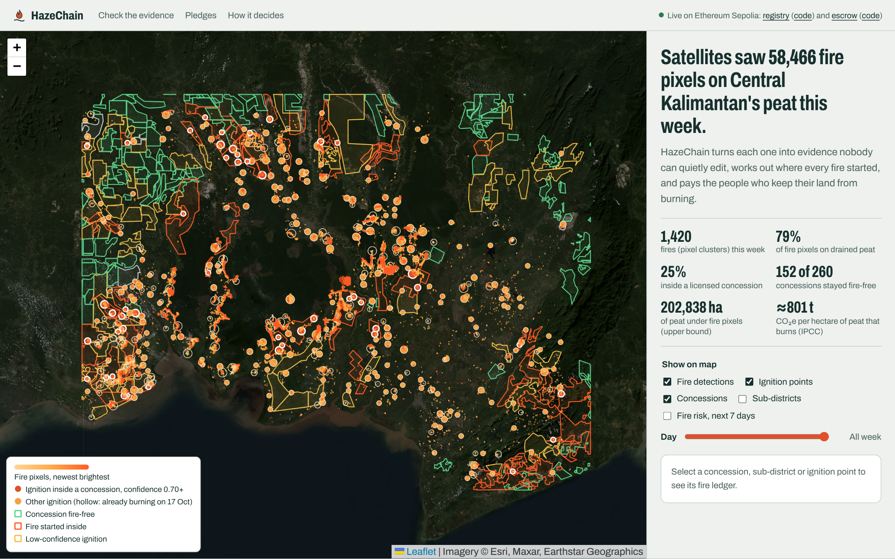
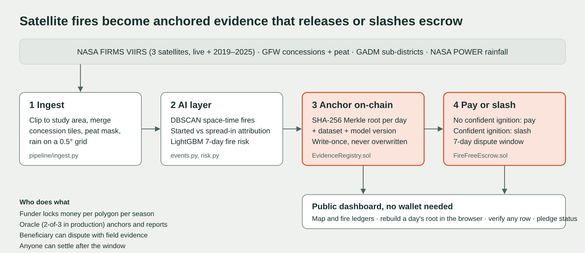

# HazeChain

**Satellite-verified peat fire evidence, anchored on Ethereum, and a smart contract that pays communities only when the satellites confirm their land stayed fire-free.**

IEEE ClimateChain Global Hackathon 2026, track: **Climate Data & Environmental Monitoring**.

- Live dashboard: https://shermaineyap.github.io/hazechain-IEEEHack/
- Contracts (Ethereum Sepolia): EvidenceRegistry `REGISTRY_ADDRESS`, FireFreeEscrow `ESCROW_ADDRESS`
- Demo video: `VIDEO_URL`



## The problem: this week

Between 17 and 24 October 2026, NASA's VIIRS satellites recorded **58,466 fire detections** in one 3° × 2.3° box of Central Kalimantan. **79% were on drained peat. Only 25% were inside a licensed concession.** Haze from these fires has pushed air quality to hazardous levels across Indonesia, Malaysia and Singapore since September ([The Star, 15 Sep 2026](https://www.thestar.com.my/aseanplus/aseanplus-news/2026/09/15/indonesia-records-1437-hotspots-as-transboundary-haze-persists)), and ASEAN has pushed its haze-free target from 2020 to 2030 ([The Star, 12 Oct 2026](https://www.thestar.com.my/aseanplus/aseanplus-news/2026/10/12/opinion---fires-and-cross-border-haze-what-can-still-be-done)).

Satellites already see every fire. What fails is what happens next:

1. **Attribution is contested.** Fires cross boundaries, so "a hotspot inside your concession" is easy to deny. Courts need evidence that nobody could have edited after the fact.
2. **Incentives are missing.** Paying villages to stay fire-free works: APRIL's Fire Free Village Programme reported a 90% drop in burnt area across its 9 pilot villages from 2014 to 2015, at about US$30,000 per village ([APRIL, 2016](https://www.rgei.com/attachments/article/565/20160102-april-group-builds-on-successful-fire-free-village-programme.pdf)). But such schemes run on one company's paperwork and goodwill, so they don't scale to governments, buyers or climate funds that need to trust the outcome.

Every hectare of drained tropical peat that burns releases about **800 tCO₂e** (IPCC 2013 Wetlands Supplement, Tables 2.6–2.7; 95% range 386–1,216).

## What HazeChain does



| Stage | What happens | Code |
| --- | --- | --- |
| 1. Ingest | Daily VIIRS 375 m detections from three satellites (NASA FIRMS), 7 years of fire history, concession and peat maps (Global Forest Watch), sub-district boundaries (GADM), rainfall (NASA POWER) | `pipeline/ingest.py`, `fetch_*.py` |
| 2. AI | Clusters pixels into fire events, finds each ignition point, decides for every polygon a fire touched whether it **started** there or **spread in**, and forecasts next week's fire risk | `pipeline/events.py`, `pipeline/risk.py` |
| 3. Anchor | Every evidence row (detection, event, attribution) is hashed; each day's SHA-256 Merkle root is written once to `EvidenceRegistry` and can never be overwritten | `pipeline/bundle.py`, `contracts/EvidenceRegistry.sol` |
| 4. Pay or slash | `FireFreeEscrow` holds a funder's money per polygon per season. The oracle reports ignitions, citing an anchored evidence day. After a dispute window: no confident ignition pays the beneficiary; a confident ignition sends the money to a fire-suppression pool | `contracts/FireFreeEscrow.sol` |
| 5. Verify | A public dashboard where anyone can rebuild a day's Merkle root in the browser and ask the contract whether a single row belongs. No wallet needed | `web/` |

### Why a blockchain, specifically

Three parties who don't trust each other need one record: the community or company being paid, the funder paying, and a regulator or court that may act on it. A database run by any one of them can be edited by that one. The registry is **write-once per day**, so no one, including us, can rewrite history after a fire. The escrow makes payment **automatic and conditional**, so a funder in Singapore or Jakarta can pay a village in Kalimantan for an outcome without an intermediary deciding who gets paid.

## Results on real data (17–24 Oct 2026)

| | |
| --- | --- |
| Detections in study area | 58,466 (S-NPP, NOAA-20, NOAA-21) |
| Fire events after clustering | 2,318 (1,420 with 2+ pixels) |
| Events already burning when the record began (censored) | 579 |
| Concessions | 260 total: **152 fire-free**, 46 with a confident ignition inside, 59 low-confidence, 3 only hit by fire spreading in |
| Sub-districts | 189 total, 158 with fire |
| Peat area under fire pixels | 202,838 ha (upper bound; a detection does not mean the whole 14 ha pixel burned) |

**Fire-risk model** (LightGBM, 0.05° cells, "will this cell burn in the next 7 days?"), always evaluated on a season the model never saw:

| Held-out season | ROC-AUC | vs. persistence baseline | PR-AUC | vs. baseline | Next-week fires in riskiest 5% of cells |
| --- | --- | --- | --- | --- | --- |
| 2025 (quiet year, 1.1% positive) | **0.826** | 0.680 | **0.143** | 0.114 | **41%** vs 36% |
| 2023 (El Niño, 7.4% positive) | **0.872** | 0.833 | **0.457** | 0.417 | **38%** vs 36% |

The baseline is "it burned here or next door last week". Neighbouring fires, recent fires and 30-day rainfall carry most of the signal. Details: [docs/MODEL_CARD.md](docs/MODEL_CARD.md).

## Live demo pledges on Sepolia

| Polygon | What the satellites show | Report | Outcome |
| --- | --- | --- | --- |
| Karau Kuala sub-district, Barito Selatan (82,396 ha, 84% peat) | No fire pixels this week | 0 ignitions | **Paid** to the village |
| Oil-palm concession GFW-OP-817 (7,438 ha, 99% peat) | No fire pixels this week | 0 ignitions | **Paid** |
| Oil-palm concession GFW-OP-877 (32,930 ha, 80% peat) | 711 pixels, 15 fires started inside, 5 with confidence ≥ 0.70 | 5 ignitions, 100% | **Slashed** to the suppression pool |
| Oil-palm concession GFW-OP-799 (13,300 ha, 81% peat) | 1 fire at confidence 0.71, 2 spread in from outside | 1 ignition, 71.3% | **Disputed**: awaiting the arbiter |

Demo pledges use test ETH and demo wallets. They are not commitments by, or accusations against, the named organisations.

## Run it yourself

```bash
# Python 3.11+, Node 18+
pip install -r requirements.txt
npm install --legacy-peer-deps

# 1. data + AI (about 3 minutes; downloads ~100 MB of public data)
bash pipeline/run_all.sh

# 2. contracts
npx hardhat test                       # 14 tests
cp .env.example .env                   # add DEPLOYER_PRIVATE_KEY (a throwaway testnet key)
npx hardhat run scripts/deploy.js --network sepolia

# 3. dashboard
cd web && python3 -m http.server 8000  # open http://localhost:8000
```

Data sources need no API keys. The deploy script anchors every evidence day, runs all four demo pledges end to end and writes `web/data/deployment.json`, which the dashboard reads.

## Repository

```
contracts/   EvidenceRegistry.sol, FireFreeEscrow.sol
test/        Hardhat tests (anchor, verify, tamper, pay, slash, low confidence, dispute, refund, double-settle)
scripts/     deploy.js: deploy + anchor + live demo flow
pipeline/    ingest, events (clustering + attribution), risk (model), bundle (Merkle), export_web
lib/         merkle.js (same algorithm as the contract and the browser)
web/         static dashboard (Leaflet + ethers, no build step) and its data
docs/        security assessment, impact assessment, model card, video script, Devpost text
submission/  one-page PDF
```

## Security and data integrity (summary)

Full assessment: [docs/SECURITY.md](docs/SECURITY.md).

- **Tamper evidence:** each day's evidence root is write-once. The test suite shows that changing one character of one row makes `verify()` return false.
- **Payment safety:** checks-effects-interactions, OpenZeppelin `ReentrancyGuard`, no double settlement, funder refund if the oracle never reports.
- **Fairness:** fires that spread in never count, attributions below 0.70 never slash, and every report has a dispute window.
- **Main residual risk: the oracle.** One key reports outcomes today. Production design: a 2-of-3 oracle set over independent satellite sources, with oracle stake slashed on an upheld dispute.

## Climate impact (summary)

Full assessment and adoption plan: [docs/IMPACT.md](docs/IMPACT.md).

At ~800 tCO₂e per hectare, **each 1,000 ha of drained peat kept from burning avoids roughly 0.8 MtCO₂e**, about as much as 170,000 cars emit in a year. A village pledge comparable to the Fire Free Village programme (~US$30,000) pays off at under US$0.04 per tCO₂e if it keeps just 1,000 ha from burning.

## Honest limitations

- **Concession boundaries** are 2012 Ministry of Forestry maps (via GFW) and may be outdated. A detection inside a boundary is evidence for investigation, not proof of responsibility.
- **Attribution confidence** is a transparent heuristic, not a trained classifier. There is no labelled ground truth for "who lit this fire" yet; a pilot with field patrol logs would provide it.
- **The 7-day window** censors fires that were already burning. A production deployment keeps a rolling record, so ignition points are known.
- **VIIRS misses** small or smouldering fires and fires under cloud. "Fire-free" means "no fire detected by three satellites", which is why the escrow allows disputes in both directions.

## Licence and data

Code: MIT. Data: NASA FIRMS (public domain), Global Forest Watch (CC BY 4.0), NASA POWER (public), GADM (academic and non-commercial use), Esri World Imagery basemap (attribution).
